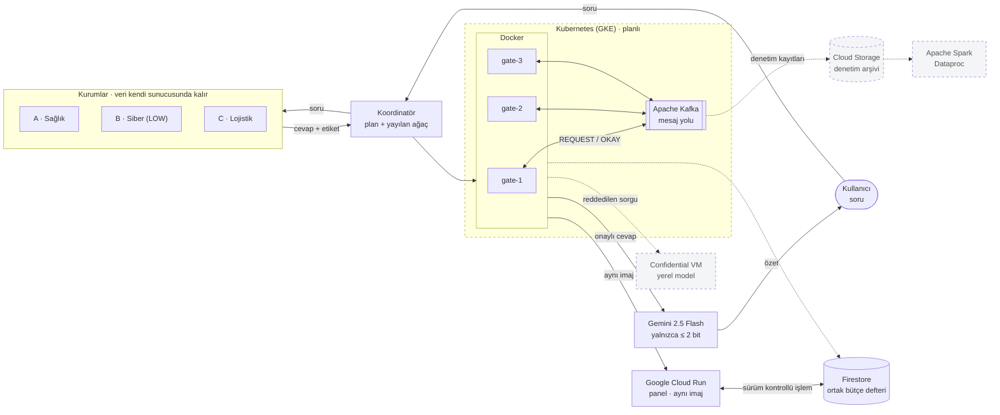

# DLM-Gate

**Dağıtık LLM ajanlarında kontrollü bilgi paylaşımı ve sızıntı bütçesi**

Birden fazla kurumun gizli verisiyle çalışan LLM ajanları ortak bir karar üretmek zorunda kaldığında, ham veri paylaşılmadan dışarıya ne kadar bilgi çıktığı ölçülebilir ve sınırlanabilir olmalıdır. DLM-Gate bu problemi dağıtık bir çalışma katmanı olarak ele alır:

- LLM serbest metin üretmez; önceden onaylanmış sonlu bir şemadan seçer (ör. Düşük / Orta / Yüksek / Kritik). Dört seçenekli bir cevap en fazla log₂4 = **2 bit** bilgi taşır.
- Her kurum, kendi verisinden toplamda en fazla kaç bit çıkabileceğini bir **bütçe** ile belirler.
- Bilginin dışarı çıkıp çıkmayacağına LLM değil, **deterministik bir kapı** karar verir.
- Birden çok kapı kopyası aynı anda çalışırken bütçenin **iki kez harcanmaması** dağıtık bir kilitle (yerelde) ya da sürüm kontrollü bir veritabanı işlemiyle (bulutta) sağlanır.

Proje, *Dağıtık Sistemler ve Algoritmalar* dersi kapsamında geliştirilmiş bir prototiptir (v0). Gerçek gizli veri kullanılmaz; deneyler sentetik ve etiketli veriyle yapılır.

---

## Nasıl çalışır?

1. **Veri kurumda kalır ve etiketiyle gelir.** Ham veri hiçbir zaman buluta taşınmaz; ajan verinin yanında çalışır. Her kurum belgesinin kimler tarafından okunabileceğini kendisi belirler (DLM, *Decentralized Label Model*). Dış kaynaklı belgeler düşük güvenilirlikli (`LOW`) işaretlenir.
2. **Sorgu ağaçta dağılır, cevaplar birleşerek toplanır.** Koordinatör yayılan ağaç üzerinden yayın (broadcast) ve toplama (convergecast) yapar: 4 düğümde 2n − 2 = 6 mesaj.
3. **Etiketler birleşir.** Ara düğümler cevapları birleştirirken etiketleri de birleştirir (⊔); okuyabilenler kesişir. Birleşim değişmeli, birleşmeli ve idempotent olduğundan koordinasyon gerekmez.
4. **Kapı karar verir.** Mealy makinesi olarak kurulan kapı altı kontrolü sırayla yapar: plan güvenilir mi, alıcı izinli mi, şema onaylı mı, düşük güvenilirlikli veri açıkça onaylanmış mı, değer şemada mı, bütçe yetiyor mu. Geçerse en fazla 2 bit dışarı çıkar ve bütçeden düşülür; geçmezse sorgu yerelde kalır.
5. **Kapı kopyaları sırayla girer.** Ricart-Agrawala ile kritik bölgeye girilir; bütçe defteri (G-Counter) OKAY mesajlarının üzerinde taşınır. Bulutta durumsuz kopyalar için aynı garanti Firestore üzerinde sürüm kontrollü işlemle sağlanır.

## Mimari

Düz oklar bugün çalışan bağlantıları, kesikli oklar ve gri kutular planlanan bileşenleri gösterir.



| Bileşen | Rolü | Durum |
|---|---|---|
| Python standart kütüphanesi | Etiketler, saatler, kapı ve kilidin çekirdeği; dış bağımlılık yok | Çalışıyor |
| Docker + Apache Kafka (KRaft) | Üç kapı konteyneri; Ricart-Agrawala mesajları ve denetim kayıtları Kafka üzerinden | Çalışıyor |
| Google Cloud Run | Aynı Docker imajıyla kontrol paneli | Çalışıyor |
| Firestore | Bulut kopyalarının ortak, sürüm kontrollü bütçe defteri (`GCP_PROJECT_ID` yoksa yerel defter) | Çalışıyor |
| Gemini 2.5 Flash | Yalnızca kapıdan geçmiş, en fazla 2 bitlik cevabı alır (`GEMINI_API_KEY` yoksa simüle) | Çalışıyor |
| Cloud Storage | Değiştirilemez denetim arşivi (ham kurum verisi buluta çıkmaz) | Planlı |
| Kubernetes (GKE) · yönetilen Kafka | Kapıların birden çok sunucuda yönetimi | Planlı |
| Apache Spark (Dataproc) | Denetim kayıtlarının dağıtık analizi (bugün düz Python) | Planlı |
| Confidential VM | Reddedilen sorguların yalıtılmış makinede yerel modelle işlenmesi | Planlı |

## Kullanılan algoritmalar

| Algoritma | Projedeki rolü | Ölçülen sonuç |
|---|---|---|
| Yayılan ağaç (Bcast / Ccast) | Sorgunun dağıtılması, cevap ve etiketlerin toplanması | 4 düğüm, 2n − 2 = 6 mesaj |
| Vektör saatler | Mesajlar arası olası nedenselliğin izlenmesi | Önce-olur zinciri ve eşzamanlı mesajlar ayrıştırıldı |
| Yarı-kafes (DLM etiketi), G-Counter CRDT | Etiketlerin ve bütçe defterinin koordinasyonsuz birleştirilmesi | Sıradan bağımsız birleşme |
| Mealy sonlu durum makinesi | Deterministik karar kapısı | 5 enjeksiyon denemesinin 5'i 0 bit ile durduruldu |
| Ricart-Agrawala (Lamport zaman damgası) | Kapı kopyaları arasında merkezsiz kilit | 3 giriş, 12 mesaj = 3 × 2(N − 1); 4 ≤ 4 bit |
| İyimser eşzamanlılık kontrolü (OCC) | Durumsuz bulut kopyalarında bütçe yazımı | 6 deneme, 3 yeniden deneme, 0 ihlal |

## Proje yapısı

```text
src/
├── core/      # DLM etiketleri, vektör saat, G-Counter, yayılan ağaç, karar kapısı
├── mutex/     # Ricart-Agrawala ve Firestore bütçe defteri
├── stream/    # Kafka olay yolu, kapı konteyneri, denetim analizi
└── web/       # Kontrol paneli (FastAPI ya da standart kütüphane HTTP sunucusu)
tests/         # Aşama aşama doğrulama testleri
presentation/  # Komut satırı demosu ve örnek çıktı kaydı
docker/        # docker-compose (Kafka + 3 kapı + panel) ve Cloud Run betiği
Dockerfile
```

## Çalıştırma

Gereksinim: Python 3.12. Çekirdek ve testler için ek paket gerekmez.

```bash
# Testler
for f in tests/test_faz*.py; do python "$f"; done

# Komut satırı demosu (tüm senaryolar adım adım)
python presentation/CANLI_VE_YEDEK_DEMO_SENARYOSU.py

# Kontrol paneli -> http://127.0.0.1:8000
python -m src.web.app
```

**Docker: üç kapı Kafka üzerinden gerçek Ricart-Agrawala**

```bash
docker compose -f docker/docker-compose.yml up -d --build
docker compose -f docker/docker-compose.yml logs -f gate-1 gate-2 gate-3
docker compose -f docker/docker-compose.yml exec gate-1 python -m src.stream.gate_worker submit
```

**Google Cloud Run + Firestore**

```bash
GCP_PROJECT_ID=<proje-id> bash docker/deploy_cloud_run.sh
```

Betik gerekli API'leri açar, Firestore veritabanını oluşturur, Cloud Run hesabına Firestore erişimi verir ve paneli yayınlar. Panelde senaryo 3c çalıştırıldığında sağ üstte **Defter: gerçek Firestore** görünüyorsa bütçe defteri Firestore'daki `dlm_gate/budget_ledger` belgesindedir; bağlantı kurulamazsa panel yerel deftere döner ve `LOCAL_FALLBACK (...)` gösterir.

## Sınırlar

- Ağaç topolojisi sabittir.
- LLM ajanlarının şemadan seçimi prototipte simüle edilir.
- Yerel kapıların bütçe defteri bellektedir; kapı yeniden başlarsa sıfırlanır.
- Ricart-Agrawala her girişte 2(N − 1) mesaj gerektirir; kapı sayısı arttıkça merkezi işlem deposu daha uygun hale gelir.

## Kaynaklar

**Dağıtık algoritmalar**

1. L. Lamport. *Time, Clocks, and the Ordering of Events in a Distributed System.* Communications of the ACM, 1978. https://doi.org/10.1145/359545.359563
2. G. Ricart, A. K. Agrawala. *An Optimal Algorithm for Mutual Exclusion in Computer Networks.* Communications of the ACM, 1981. https://doi.org/10.1145/358527.358537
3. F. Mattern. *Virtual Time and Global States of Distributed Systems.* Parallel and Distributed Algorithms, 1989.
4. M. Shapiro, N. Preguiça, C. Baquero, M. Zawirski. *Conflict-Free Replicated Data Types.* SSS, 2011. https://doi.org/10.1007/978-3-642-24550-3_29
5. H. T. Kung, J. T. Robinson. *On Optimistic Methods for Concurrency Control.* ACM TODS, 1981. https://doi.org/10.1145/319566.319567

**Bilgi akışı kontrolü**

6. A. C. Myers, B. Liskov. *A Decentralized Model for Information Flow Control.* SOSP, 1997. https://doi.org/10.1145/268998.266669
7. S. Zdancewic, A. C. Myers. *Robust Declassification.* IEEE CSFW, 2001.
8. G. Smith. *On the Foundations of Quantitative Information Flow.* FoSSaCS, 2009. https://doi.org/10.1007/978-3-642-00596-1_21

**LLM ajan güvenliği**

9. E. Debenedetti vd. *Defeating Prompt Injections by Design* (CaMeL), 2025. https://arxiv.org/abs/2503.18813
10. M. Costa vd. *Securing AI Agents with Information-Flow Control* (FIDES), 2025. https://arxiv.org/abs/2505.23643
11. S. A. Siddiqui vd. *Permissive Information-Flow Analysis for Large Language Models*, 2024. https://arxiv.org/abs/2410.03055
12. O. Tailor. *Verifier-Bound Communication for LLM Agents: Certified Bounds on Covert Signaling*, 2026. https://arxiv.org/abs/2603.00381
13. E. Debenedetti vd. *AgentDojo: A Dynamic Environment to Evaluate Prompt Injection Attacks and Defenses for LLM Agents.* NeurIPS, 2024. https://arxiv.org/abs/2406.13352

---

**Ali Tüydür** · [LinkedIn](https://www.linkedin.com/in/ali-tuydur/) · [GitHub](https://github.com/alituydurr) · [Medium](https://medium.com/@tuydur.ali)
